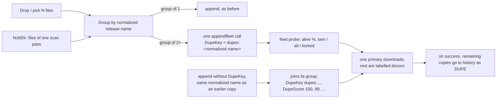

# Drop as fleet: NZBs added together are one fleet

Status: built (2026-11-22), with both follow-ups: the NzbDir scanner and the
daemon-side join; F16 (fleets stay in Downloads) built 2026-11-23.

## What happened before

Dropping several NZBs of the same release on the web UI at once (or picking them in the Add dialog) sent one `append` call per file (`webui/upload.js` `fileNext`), each with an empty DupeKey. RustyGet then treated them as unrelated downloads:

- no fleet probe, so no `DupeCopyKind` and no TWIN / borrowable alt / non-borrowable alt labels
- the success clean-up of queued copies never ran (`dupecoord.rs` `nzb_completed_host` needs a non-empty DupeKey), so after one copy finished the next would start and download the release again
- dead copies were only found one at a time, as each reached the head of the queue
- names differ only by a suffix the browser or indexer added (`…FraMeSToR_5.nzb`, `…FraMeSToR (1).nzb`), so name matching (`dupecoord.rs` `same_name_or_key`, exact names when there is no DupeKey) did not join them either

Seen on 2026-11-22 with 19 copies of one UHD remux dropped together: no labels, 15 dead copies parked one by one. A direct article check showed only 2 were alive, and both carried the same MKV as the rest (sampled bytes identical at the same offsets).

The same day the user copied about 15 NZBs of `Dune.Part.Two.2024.UHD.BluRay.2160p.TrueHD.Atmos.7.1.DV.HEVC.REMUX-FraMeSToR` into NzbDir with Finder. That path goes through the NzbDir scanner, not the web UI, and showed the same faults: every copy DupeKey '' and DupeScore 0, all downloading at once, nine of them parked as FAILURE/HEALTH with "no duplicate in history to fail over to" while three siblings were still queued, and a shown health of 98.8 to 99.9% for copies judged on a projected 0%.

## Built

**NZBs added together are one fleet when they are the same release, whatever added them.**

### The name rule

One strict rule, in Rust and mirrored exactly in JavaScript:
`releasename::group_name` (`rust/src/releasename.rs`) and
`DupeGroup.groupName` (`webui/dupegroup.js`) take the name without its copy
suffix (`strip_copy_suffix`), lowercase it and make every run of separators
(spaces and `. _ - ( ) [ ] { } + , '`) one dot. Nothing else is dropped: the
resolution, source, codec, edition and group stay, bracketed ones too
(`[1080p]`), so the 1080p and the 720p, the REPACK and the original, two groups
and the first film and its sequel never share a name. The same cases run in the
Rust unit tests `copy_suffixes_strip_only_after_a_group_tag` and
`copy_suffix_never_hides_the_group` and in `tests/webui/dupe-group.js`.

`strip_copy_suffix` removes:

- the scanner's `.queued`, `.N.queued`, `.nzb.N` and repeated `.nzb` endings;
- a trailing ` (N)` (browsers), always;
- a trailing `_N`, `.N` or `-N` (any number of digits) only when what is left
  ends in a scene group tag (a last word with a `-` and a word of letters and
  digits holding a letter) AND the name carries release markers (a year, a
  resolution or SxxEyy): `…REMUX-FraMeSToR_3434`, `…1080p-GRP_2`.

`Iron-Man-3`, `Spider-Man.2`, `Toy-Story-3`, `Movie.Part.2`, `DDP5.1` and
`Show.S01E01-02` keep their numbers. The release parser (`releasename::parse`,
`webui/releasename.js`) strips a copy suffix the same way first, so
`…-FraMeSToR_3434` parses with the group FraMeSToR.

The DupeKey of a group is `dupes:<group name>`, for example
`dupes:dune.part.two.2024.uhd.bluray.2160p.truehd.atmos.7.1.dv.hevc.remux.framestor`.

### Web UI (Add dialog)

1. **Grouping** happens in the Add dialog, before upload (`webui/upload.js`,
   `DupeGroup.plan`). Files whose group names match form one group. A group of
   one stays a plain `append`.
2. **One fleet per group:** `appendfleet` with all of the group's files, the
   dialog's category and priority, and DupeKey `dupes:<group name>`. If the user
   typed a DupeKey for one of the files, theirs is used instead. A file with a
   password goes in on its own, as a fleet has no per-copy parameters.
3. **The dialog shows the grouping** before Submit ("19 files → 1 fleet:
   Dune.Part.Two…FraMeSToR"), with the checkbox "Add copies of the same release
   as one fleet", on by default. When it's off, every file goes in on its own as
   before, with the nzb parameter `DupeJoin=no` so the daemon-side join leaves it
   alone too.
4. **Force** (the "DupeForce" box) keeps the old behaviour: every file is its
   own download in DupeMode FORCE, with no fleet and no join.
5. **Exact duplicate files** (same content) are dropped in the dialog before
   upload, so they don't cost a probe.

### NzbDir scanner (was follow-up a)

A plain `.nzb` dropped into NzbDir (not one the API wrote there) waits for the
end of the scan pass (`scanner.rs` `flush_fleet_pending`). Files of one release
(the same category and group name, `scanner::plan_fleets`) that landed in that
pass go in as one fleet through the same `appendfleet` code, on a thread of its
own, under DupeKey `dupes:<group name>`. A copy of the release that lands within
`FLEET_WINDOW_SEC` (10 s) of a fleet started from NzbDir joins that fleet the
same way (the fleet's "backup sent later" path). A file alone in its pass is
added as before. The original files are renamed `.queued` as before; the file
of each copy the fleet added is then removed, since the fleet wrote its own.
This needs `DupeCheck=yes`, and is off while a scan script is set.

### Daemon side (was follow-up b)

`dupecoord.rs` `join_copy_group_host`, called first in the duplicate check of
every new download: a download without a DupeKey, not in DupeMode FORCE and not
marked `DupeJoin=no`, joins the queued or history downloads of the same group
name that have no DupeKey either (or already have the group's key). All of them
get the DupeKey `dupes:<group name>` and a DupeScore in the order they came
(`DupePrimaryScore`, 100 by default, for the first, then 99, 98, ...;
`dupecoord::next_group_score`), and the log says "Grouping X with N other
copy(ies) of the same release". The duplicate check that follows then does what
DupeMode SCORE always did: the copy that came first downloads, the
rest wait in history as backups, and TwinCheck labels each one (it only looks at
downloads with a DupeKey).

### To the front, probed with about 1 MB each

A group goes to the front of the queue at once: a fleet with a `dupes:` key adds
its copies at the top (`dupesearch_coord.rs` `scanner_add_external`, `add_top`),
and the daemon-side join moves the queued copies of the group to the top.

Each copy is scored from a probe of about 1 MB of articles
(`dupesearch_coord.rs` `GROUP_PROBE_BYTES`), never by downloading it:

- the STAT checks spread over the whole posting cost no bytes, so a dead tail
  shows in the alive share;
- the kind probe reads two articles (the par2 file list and the head of the
  largest file: twin by par2 list, encrypted or locked headers);
- the alive share comes from STATs alone (`group_probe_body_checks` gives a
  grouped fleet no BODY checks since F16); BODY reads are kept for the few
  header and par2 articles whose content the kind probe needs, and for one or
  two par2 volume tail articles when the index is lost (F2b,
  `group_salvage_budget`);
- the payload intake, which reads an article of every volume to map the video
  inside, is skipped for such a group: copies of one release name are matched
  by TwinCheck's par2 lists instead, and an unverified copy stays in the fleet.

After the probe only the best copy downloads. The others stay as scored,
labelled backups that lend articles when the primary misses them; no backup is
downloaded in full while the primary can still finish.

### Imperfect copies stay donors

(Superseded for copies grouped by name by F16 below: their backups and kept
donors wait held in the queue, not in history. This section still describes
a fleet of a client's own key, and copies kept in history by an earlier build.)

Only the best copy downloads. Every other copy stays in the fleet as a backup
(DELETED/DUPE in history) ranked by its alive percentage, which the web UI shows
beside it ("donor · 48.0% alive"); a copy with nothing alive is shown as "dead
donor" and keeps its nzb-file. A copy that is tried and fails its health check
(parked) while its fleet is open is no longer filed FAILURE/HEALTH:
`dupecoord.rs` `keep_as_donor_host` files it as a backup too, with its measured
alive share as `DupeAlive` and `DupeParked`, keeps its files and nzb-file, and
failover never picks it again (`tried_delete_status` shows it to failover and
the duplicate check as parked on health). The fleet is open while another copy
of its key is queued or waits in history and none succeeded. The parking
message also counts the copies still queued ("N other copy(ies) of it still
queued, so it stays in their fleet as a donor"). After the primary succeeds the
remaining copies are in history as DELETED/DUPE, and nothing downloads again.

### Honest health

A download judged from a sample (dead or doomed from the articles tried so far,
or hopeless) gets the nzb parameter `DupeProjected`: the projected health in
percent. Its `Health` still counts every untried article as good, which is why
a copy projected at 0% showed 98.8% before. The web UI shows "projected health:
N%" instead of the health label for such a download, uses it in the score
badge, and shows a kept donor's `DupeParked` the same way.

### Classification rules (F6 to F10)

- **Timeouts are never evidence (F6).** The fleet's health check counts only
  articles a server said it has or lacks (`dupesearch_nzb.rs`
  `eval_fleet_member_health`); a check that timed out or failed with a
  temporary error leaves the copy unknown: Alive -1, no `DupeAlive`, never
  DEAD and never 0% alive. The intake already leaves a copy it ran out of time
  for unverified, and TwinCheck retries a sample that read too little.
- **The check budget is per copy (F7).** A grouped fleet's time limit is 60 s
  for each copy (`group_check_timeout_sec`), and its kind probe gets up to 60 s
  for each round of 16 copies, instead of one window for the whole fleet.
- **The nzb's password reads encrypted headers (F8).** The kind probe reads a
  copy's first archive article with the password from its `<meta
  type="password">` or a `{{password}}` in its name (`summary_password`,
  `summary_take_name_password`); `donorkind::rar_packing` opens encrypted RAR
  headers with it (zipfast). A 7-Zip keeps its headers at its end, so a
  passworded 7-Zip is classed encrypted from the password alone.
- **Other par2 checksums are other packing, not another video (F9).** TwinCheck
  labels such a copy `container` until the video inside both copies matches
  (`DupeInner`), which makes it an `alt`. The web UI shows `container` as
  "unverified" (`DupeGroup.kindLabel`), never as another encode.
- **The primary is the healthy copy easiest to borrow into (F10).** After
  ranking, the healthy copy (at least 97.5% alive, not locked) with the easiest
  packing leads (`donorkind::primary_ease`, `dupesearch_nzb::lead_easiest_healthy`):
  bare or split media, then a stored archive, then a compressed archive or a
  7-Zip, then an encrypted one. Health still gates: a weak plain copy never
  leads a healthy one. The backups keep their order (twins first).

- **Alt identity without par2 (F11).** (a) A grouped fleet reads each copy's
  archive identity, the size and CRC32 of the video its last volume's header
  (RAR) or its 7z header records (`dupeintake::inner_key_copy_with`, two
  articles), with the nzb's password for encrypted headers
  (`twinfields::rar_last_volume_key_with`), and stores it as `DupeInnerCrc`;
  TwinCheck makes a container an `alt` when the keys match. F11a: the RAR key
  is read through `zipfast::map::last_volume_identity` (zipfast pinned at
  21474cf) from the last volume's first article: the final size and CRC32
  and/or BLAKE2sp of the member ending there, keyed checks (RAR 5 AES data)
  too. `twinfields::same_inner_key` compares every check both keys record;
  keyed checks only with keyed ones, and two keyed values that differ may be
  one file under two passwords, so they never make `other`.
  (c) Sizes that differ only by a header-sized amount (at most 1 MiB, such as
  an mkv without its 11,245-byte Tags tail) are a likely alt
  (`twinfields::same_inner_key` gives no verdict), so the copy stays an
  unverified container that borrows with per-range checks, never `other`.
  (b) Aligning stored copies by MKV landmarks uses only what the payload map
  gives today: `OPEN ITEM (zipfast): MKV landmark reader`.
- **Borrowed alt bytes pass a structural check (F12).** Stream repair calls
  `streamrepair::validate_borrowed_range` before it writes bytes borrowed by
  the video's offset. It runs `vidmatch::validate` (vidmatch pinned at
  636facc) over the range with the target's own good bytes around it as
  context: back to the start of the Cluster holding it (`vidmatch::find_cluster`
  in up to 8 MiB of good bytes before it) and up to 2 MiB after it, with the
  Tracks from `vidmatch::parse_head` on the video's first bytes when they are
  held. Bad: never written, another donor is tried or the range fetched
  again. Unknown (too little context, no Tracks, not Matroska): written, and
  the whole-file CRC32/BLAKE2 or par2 stays the gate. Ok proves the structure
  only (headers, sizes, block headers, lacing, any CRC-32 element held whole).
- **A lost index par2 is salvaged (F2b).** When a copy's index `.par2` cannot
  be read, the fleet probe (`dupesearch_coord::salvage_copy`) and TwinCheck
  (the "Fingerprint ... lost" case) fetch one or two articles at the tail of
  its smallest par2 volume (`par_rs::salvage::plan_critical_articles`, par-rs
  pinned at 482b936), keep the packets whose MD5 matches (`salvage_sets`,
  `best_set`) and compare copies with `compare_identity`: Twin, Different or
  Unknown, never a guess. TwinCheck stores the salvaged file list as the
  copy's fingerprint. The alive share comes only from sampled articles: a
  lost fingerprint never makes a copy dead.

Open item (F2a): par-rs #87 is merged (b2ba9e5) but not pinned here yet; the 1 MB probe is to switch to
`par_rs::probe::{plan_probe, check_probe}` (slice-verified Match, Mismatch or
Incomplete; probed slices that match the same IFSC are twin evidence). It is
marked `OPEN ITEM (par-rs)` at `GROUP_PROBE_BYTES`.

### Review fixes (4f9955b4 review)

- **Only fleet members are kept as donors.** A download that fails its health
  check is kept as a donor only when it belongs to a fleet (a `dupes:` key or
  `DupeFleet`, `dupecoord::is_fleet_member`). A plain user or client key keeps
  FAILURE/HEALTH, as before.
- **The last copy standing fails visibly.** It is kept as a donor only while
  another copy can still complete the release (queued, or an untried backup in
  history that is not dead: `dupecoord::live_fleet_copies`); otherwise it ends
  FAILURE/HEALTH.
- **The daemon join is strict.** Only the strict group name above, the same
  category and the same DupeMode, and never a copy with a DupeKey of its own;
  the queued copies move to the front only when a real fleet forms (another copy
  queued). After a restart the keyless copies are grouped by id without
  reordering the queue.
- **appendfleet for a `dupes:` key answers at once** with every member
  `PROBING`, then checks and adds the copies in the background
  (`dupesearch_coord::fleet_append_rpc`), so the Add dialog closes at once. Other
  keys (clients) are checked within the call as before.
- **NzbDir copies are never stranded.** When the fleet call did nothing (the key
  busy, the program stopping, no member through) or could not start, the copies
  get their names back and the next scan sends them again
  (`scanner::fleet_never_ran`).
- **The Add dialog** groups only `.nzb` files; with Add paused or Auto-category,
  or a file with a password or a DupeScore of its own, the files go in on their
  own, honouring those options; exact copies are reported in the file list and
  by the notification.
- **One health everywhere.** `DownloadsUI.shownHealth` is the health the lists,
  the details dialogs and the fleet panel show: `DupeProjected`/`DupeParked`, or
  for a copy that fetched nothing yet the health check's `DupeAlive`/`DupeHealth`
  (the better one). A fleet member's pill shows its place and alive share
  (`#2 · 97.0% alive`), never 100% beside dead. `DupeAlive` keeps the measured
  share also for a copy ranked dead for too few alive articles, so only 0% is
  "dead donor".

### Passwords (review C of cda2ae7d)

- **No password in a key.** `{{password}}` is cut before a name is grouped. A
  group key an earlier build stored with the password's words in it (it read
  `{ }` as separators: `dupes:movie.2024.grp.s3cret`) is rebuilt from the name
  once the queue is loaded (`releasename::rebuilt_group_key`, in the queue and
  in history); a key without the password's words is left alone.
- **No password in a log line or a reply.** Every log line of the fleet paths
  (web UI, client, NzbDir, the background checks) goes out through
  `dupesearch_coord::fleet_log`, and the grouping, keeping and rescue lines
  through `releasename::log_name`, so neither shows a `{{password}}`. The
  `PROBING` reply of a `dupes:` fleet echoes the names without it (the Add
  dialog matches them that way); a client's key keeps its reply as before.
- **A fleet written back to NzbDir keeps its options.** Its members go into the
  category's folder, with a ` (N)` suffix (one the grouping ignores) when a
  file of that name is there, and a priority other than 0 in a hidden file
  beside each (`.<name>.nzb.priority`), which the scan reads once. A failed
  write, and a check that could not start, are logged.

## F16: fleets stay in Downloads (built 2026-11-23)

The user: "you should have them all be in the downloads, but have it so it is
collapsed but you can uncollapse it and see all the nzb's attached; it
shouldn't move these duplicates to history". This overrides how F3 was built
for copies grouped by name (a `dupes:` key, DupeMode SCORE, DupeCheck on):

- **Added at once, held, probing.** `appendfleet` (and the NzbDir scanner,
  through the same code) adds every copy to the queue before the probe,
  paused at priority -100 with `DupeHeld=yes` and `DupeProbing=yes`
  (`dupesearch_coord::fleet_append`, `scanner_add_external_paused`), so the
  copies show in Downloads as "probing…" right away. The key lock is held only
  while copies are added and while what the probe found is written, not for
  the probe (a client's fleet, which adds only after its probe, keeps it
  throughout).
- **One copy downloads, the others are held.** After the probe its findings
  are written on each copy (`fleet_apply_member`: rank, kind, alive share,
  `DupeEase`, score), and `fleethold::refresh_key_host` releases the first live
  copy in failover order. Every other copy stays held: paused, priority -100,
  never downloaded in full, and still a donor (the article fallback reads
  queued copies). The duplicate check holds a copy that loses to a queued one
  instead of moving it to history (`dupecoord::nzb_found_host`).
- **Failover to the next held copy.** A primary that fails its health check
  is held as a donor (`DupeParked`, `DupeAlive`) and the next live held copy
  is released (`fleethold::park_on_health_host`, at every parking site of
  `queuecoord.rs`); `find_dupe_backup_host` returns the next held copy, and
  `return_best_dupe_host` releases it instead of returning a history item.
  A copy deleted by hand fails over the same way.
- **Only success or total failure ends it.** When the primary succeeds every
  other queued copy goes to History as DELETED/DUPE, its nzb kept
  (`fleethold::fleet_succeeded_host`, whatever the HealthCheck mode). When no
  live copy is left, the held copies go to History as FAILURE/HEALTH with the
  last one (`fleethold::fail_held_host`); a fleet whose every copy probed dead
  goes there at once (`fleet_drop_pre_added`).
- **F16a: one order.** `fleethold::failover_order` ranks the held copies:
  healthy copies (at least 97.5% alive) first, by ease of borrowing into
  (bare/split, stored RAR, compressed, encrypted: F10), twins before alts;
  then weak copies by alive share; locked copies; unverified copies; dead and
  parked copies last. The queue coordinator writes it every second as
  `DupeFleetOrder` (0 the primary, 1 next, 2, 3, ...) and `DupeFleetPrimary`
  on every copy, and failover takes the first live copy of the same order, so
  the web UI shows exactly what failover will pick; JavaScript never re-ranks.
- **Downloads shows one row per fleet** (`webui/downloads.js`
  `DownloadsUI.buildFleets`, `buildFleetRow`): the primary with a "+N copies"
  toggle, collapsed by default, open or closed remembered per viewer in
  `localStorage` (`DownloadsFleetOpen`, inside try/catch). Opened, every copy
  in `DupeFleetOrder` with its place (primary, next, 2, 3...), its label (twin,
  alt, container, other, locked, unverified, dead, NN% alive) and its state
  (probing…, held donor, held donor (tried), downloading).
- **Probe speed.** The alive share comes from STATs; each request waits at
  most `fleetprobe::PROBE_IO_TIMEOUT_SEC` (5 s; a timeout leaves the article
  unknown, F6); while downloads run the probes take at most half of a
  server's connections (`fleetprobe::probe_share`; with downloads held they
  may take them all) and a grouped fleet no longer pauses the downloads, so
  the primary keeps the rest. Every probe request gets its connection through
  `fleetprobe::probe_connection` (STAT batches and, through
  `fleetprobe::ProbeNntpHost`, BODY reads): moving the probes to the light
  pool of branch `light-pool` (F17) changes that one function. Each copy's
  probe is logged: "Fleet probe of X: N ms, N request(s) sent, N answered (N
  present, N missing), N timed out or failed".

Review fixes (becee83b review):

- **A health failure during another submission's probe** never fails the
  copies still being probed: the failed copy is held as a donor and the
  fleet's refresh decides once the probe is over.
- **A fleet with no live copy left ends**, however its last copy failed
  (health check, post-processing, HealthCheck=Delete, a delete by hand):
  `fleethold::end_fleet_host`, run from the refresh and from the duplicate
  coordinator's completion, moves the held copies to History with their nzbs
  and files: dead ones (nothing alive) FAILURE/HEALTH, the others DELETED/DUPE
  donors (F3).
- **A release resumes only what the hold paused** (`DupeHeldFiles`): files
  the user paused and extra par2 volumes stay paused. A copy held as it was
  added resumes as a fresh copy (every file, then the extra par2 volumes
  paused again unless ParCheck is Force).
- **Exactly one copy downloads**: the primary is decided after a new copy is
  in the queue (`prepost::nzb_added`), not in the duplicate check, which runs
  before it is queued.
- A copy leaving its fleet gets its own priority back (or the user's, set
  while it was held); a copy failover refuses (locked) is never released by
  the refresh, and place 1 ("next") is always the copy failover takes, never
  one being probed, locked or dead; "Found duplicate", "Failing over" and
  "Cancelling download" lines and the Downloads list show no `{{password}}`;
  a copy sharing the primary's folder goes to History without its files
  deleted; copies already added when the program stops during a probe are
  never written back to NzbDir.

Re-review fixes (bde1b0c4 re-review):

- Ending a fleet walks its held copies by id, finding each again before it
  is deleted (a delete can complete inline and, with KeepHistory=0, free the
  copy), and a nested end or refresh of the same key does nothing
  (`fleethold::BusyKey`).
- A copy that shares the primary's folder (compared once resolved, and
  ignoring case on macOS) or that a fleet ends with is marked
  `DupeKeepFiles`: no delete mode cleans its disk.
- The web UI counts `UnpackPassFile` as a password, as the daemon does, so
  "next" and "locked" match it.

Changed expectations (functional): `dropjoin` (backups held in the queue, not
in history, until the primary succeeds), `dropkeepdonor` (the failed copy is
held in the queue as a donor, then DELETED/DUPE), `dropallfail` (both copies
end FAILURE/HEALTH), `dropallfailnonzb` (a held backup needs no nzb-file: it
completes), `dropnzbdir` (every copy queued in front of the item queued before).

## End-to-end fixes (fleet-e2e-6790, 2026-11-23)

A real drop of the Dune copies on the test server (6790, a LAN NNTP proxy
that answers a missing article only after 1.3 to 1.8 s) found these; the
branch `fleet-e2e-fixes` fixes them:

- **B1, the per-copy budget (F7) and a primary that never waits for slow
  copies.** Each copy's STAT check now runs for at most its own 60 s
  (`DonorOptions::posting_budget_ms`); what it measured by then is kept, its
  probe line says it was cut, and the copy carries `DupeAliveCut=yes` (the
  web interface shows "~N% alive (found/asked sampled, cut short)"). Each
  copy is asked several requests at once, each on a connection of its own
  (`DonorOptions::lanes`, `FLEET_PROBE_LANES` = 4), instead of one walker per
  server whose pipeline shrank to one STAT at a time. A grouped fleet adds its
  copies, reads their kinds and archive keys and samples their alive shares at
  once (`fleet_append`, the `grouped` branch); the kind probe takes the copies
  from one queue (no chunk waits for its slowest copy), healthy copies first
  and never one proven dead. As soon as a copy is proven healthy and is the
  easiest to borrow into of the copies probed so far (`pick_lead`), it is
  released as the primary (`fleet_lead_release`) while the others are still
  probed; a copy proven healthy later replaces it only when strictly easier
  to borrow into and only while the primary has downloaded less than
  `FLEET_SWITCH_MAX_BYTES` (512 MiB); otherwise it is just ranked. The nzb
  files of a fleet are parsed in parallel (150 MB of XML for that drop).
- **B2, the older backup pass.** DupeSearch/DupeWatch's "Dupes: checking the
  backups" pass leaves a fleet that stays in Downloads alone
  (`dupesearch_coord::fleet_owns_pick`): it re-sampled every copy after each
  primary change, wrote `DupeAlive=0` over a 17% donor (ranking it under a
  dead copy), demoted picks still being probed and ran for a copy just
  deleted. Its log line says "queued" for a queued backup, not "in history".
- **B3, icons.** The bundled icon subset (`webui/lib/material-symbols-rounded.*`,
  fetched from Google Fonts with the `icon_names` list in its json) lacked
  `chevron_right`, `expand_more` and `folder`, so the fleet toggle showed
  their names as text; they are in it now.
- **B4, logs.** The NzbDir fleet summary names what downloads first
  ("downloading #N; 17 cop(ies): 1 QUEUED, 13 BACKUP, 3 SAME_POSTING") and
  lists the copies over lines of at most 900 bytes instead of one line cut at
  1023 (`scanner::fleet_summary_lines`). "Error reading diskstate ...
  queue/19464" came from the failed-article recheck of a download moved to
  history: it read the article list of a file deleted with the download; it
  now skips a file whose list is gone (`diskstate_format::active_file_info_exists`).
- **B5, "next".** Place 1 (`DupeFleetOrder=1`) goes only to a copy failover
  can take now; while every held copy is still probed, locked or dead the
  places start at 2 (`fleethold::display_places`).
- **F4.** `Health` keeps NZBGet's meaning; the API page documents
  `DupeAlive`, `DupeAliveSample`, `DupeAliveCut`, `DupeProjected`,
  `DupeParked` and the fleet parameters for clients.
- **F11.** C04 and C11 got no inner key because the first article of their
  first volume is gone (430 on the proxy), and the key reader gave up before
  it read the last volume. A set named as RAR volumes is now keyed from its
  last volume's head alone, the first volume's size read from another of its
  articles. C11 lacks its last volume's head too, so it stays unkeyed (never
  a guess). zipfast `map::set_identity` (c825529) is not pinned yet:
  `OPEN ITEM (zipfast)`.
- **A paused server never stalls a probe (F6, F7).** After three failed
  exchanges in a row a server is paused for 30 s, and a check whose only
  server was paused slept through the pause inside the copy's budget. The
  fleet probe sets `DonorOptions::skip_paused`: the paused server's articles
  are unreached at once, so a copy no server answered is unverified (never
  dead). A sample the pause cut short counts as cut (`DonorHealthResult::paused`,
  `DupeAliveCut`): it needs ten real answers to settle, so a copy is never
  called dead on the few 430s it got before the pause. The background health
  check asks such a copy once more after the pause, within the fleet's
  deadline, while the primary downloads; the second check replaces the first
  only when it measured at least as many articles.
- **Ten STATs could not tell 0% from 2%.** A copy whose first ten sampled
  articles are all missing gets 30 more within its budget
  (`DonorOptions::dead_extra`) before it is called dead, and carries
  `DupeAliveSample` ("dead (0/40 sampled)").

Review fixes (76a80014 review):

- The backup pass skips only real fleets: a `dupes:` key alone is what
  DupeSearch writes onto every download it searches, so it also needs a
  fleet's own marks, its rank (`DupeFleet`), its membership
  (`DupeFleetMember=yes`, written when a fleet adds the copy and never cleared,
  so a restart in the middle of a probe keeps it) or the probe's `DupeProbing`,
  on itself or on a queued copy of its key (`pick_fleet_marked`). A plain
  `DupeHeld` is no fleet mark: the duplicate check holds ordinary DupeSearch
  backups too. Ordinary searched downloads keep their retry and re-ranks,
  with a held backup as well (functional `watchsearchedkey`).
- The 512 MiB switch guard reads the per-article counters
  (`leader_downloaded_bytes`): the finished-file sizes stay 0 for a single
  big file until it completes.
- A cut copy leads early only with at least ten answers; an early leader that
  fails its health check or is deleted during the probe hands the lead to the
  next healthy probed copy at once; the reply names a leader only when it
  succeeded (any copy of the fleet that finished during the probe), else says
  why nothing downloads; the probe's findings are written onto a copy in
  history only when its primary's success filed it or it succeeded itself
  (`fleet_history_writable`), and no copy in history keeps a hold or probe mark.
- The kind probe skips only a copy proven 0% alive: a weak donor under
  DupeMinAlive still gets its kind, lock and inner key
  (`kind_probe_skips`), so a locked one is never failed over to; its
  workers wait for the health check while only 0% copies are left, since
  the check after a pause can still find one alive.
- `DupeAliveCut=no` replaces an early leader's `yes` once a full check
  measured its sample. A fleet copy in history that the user deleted or
  that failed is not reported as added. A fleet owns its picks for the
  backup pass only while it is open (`fleet_pick_owned`): a fleet that
  ended with every copy in history is searched by DupeSearch again.
- An early primary that finished downloading or is in post-processing is
  never held again for an easier copy (`fleet_leader_switchable`); the
  easier copy is only ranked.
- A check the fleet's own deadline cut counts as cut, like one its copy's
  budget cut. The check after a pause waits until no server is paused (within
  the fleet's deadline) and does not hold the fleet check lock meanwhile; a
  pause another walker set after a walker looked is not slept through either
  (`DonorServer::ask_opts`).
- The icon subset is pinned (`revision`, `sha256`, `font_size`, checked by
  `fleet-downloads.js`) and `docs/rust-migration/dependency-sources.json`
  records its new bytes; the NzbDir summary never cuts a UTF-8 character.

## Done when (acceptance tests)

| Done when | Test |
|---|---|
| Dropping 3+ copies of one release creates a single fleet: one item downloading, the others labelled TWIN / borrowable alt / non-borrowable alt in Downloads. | functional `dropnzbdir` (NzbDir drop of 5 copies plus an exact copy: one primary, every other copy DupeKey `dupes:…`, DupeScore > 0, the partly alive copy `DupeKind=twin`, the dead ones `DupeAlive=0`); web UI `tests/webui/dupe-group.js` "suffixed copies form one fleet" |
| After the primary succeeds, the other copies go to history as DELETED/DUPE, and nothing re-downloads. | functional `dropnzbdir` (one SUCCESS, the other copies DELETED/DUPE, no article tried by any backup), `dropjoin` |
| Dropping copies of two different releases at once creates two fleets. | functional `dropnzbdir` (second release, its own key and one SUCCESS); web UI `dupe-group.js` "two releases form two fleets"; Rust `scanner::tests::nzbdir_copies_of_one_release_form_one_fleet` |
| A partially alive copy (for example 19 of 40 sampled articles) stays queued as a low-priority donor with its alive % shown. It is not marked FAILURE/HEALTH, and the primary borrows from it. | functional `dropnzbdir` (19 of 30 alive: DELETED/DUPE with its DupeAlive, labelled a twin by TwinCheck, the primary recovers its 2 missing articles from it); `dropkeepdonor` (a tried copy that fails its health check is kept as a donor, DELETED/DUPE, not FAILURE/HEALTH) |
| A copy with nothing alive is labelled dead, stays in history with its nzb, and is never deleted. | functional `dropnzbdir` (`DupeAlive=0`, nzb-file still in NzbDir), `dropkeepdonor` (`DupeParked` near 0, nzb-file kept) |
| Exact duplicate files are dropped before upload. | web UI `dupe-group.js` "exact duplicate files are dropped before upload"; functional `dropnzbdir` (the exact copy in NzbDir is SAME_POSTING, not added) |
| With the checkbox off, or with Force on, behaviour is exactly as today. | web UI `dupe-group.js` "box off or Force on: every file on its own, as before"; functional `dropjoin` (`DupeJoin=no` and DupeMode FORCE copies keep no DupeKey and each downloads) |
| Web UI tests cover the grouping (suffix stripping, two releases, a single file, a user-supplied DupeKey). | `tests/webui/dupe-group.js`; Playwright `tests/webui/drop-fleet.js` (the Add dialog's preview, box on by default, box off and Force as plain appends, two releases as two fleets; Downloads: one primary, twin, alt and unverified backups, projected health; History: donors never FAILURE/HEALTH, DELETED/DUPE after the primary succeeds; no console errors) |
| The NzbDir scanner treats files of one release in one scan pass as one fleet. | functional `dropnzbdir`; Rust `scanner::tests::nzbdir_copies_of_one_release_form_one_fleet` |
| Items with no DupeKey and the same normalized name join one group, whatever added them. | functional `dropjoin`, `dropjoinrestart` (keyless copies already queued join once after a restart; the sequel stays apart); Rust `dupecoord::tests::group_scores_follow_the_order_copies_came` |
| A group goes to the front of the queue, and each backup sends at most about 1 to 2 MB during intake. | functional `dropnzbdir` (queue order with an item queued before the drop; nserv request log: bytes served per backup copy at most 2 MB, borrowed articles included), `dropjoin` (the joined copy moves in front of an item queued before it); Rust `dupesearch_coord::tests::grouped_fleets_sample_alive_by_stat_only` |
| The shown health is the one a copy was judged on. | functional `dropkeepdonor` (Health above 90%, DupeProjected under 10%) |
| F6: a copy whose checks timed out is unverified, never dead. | Rust `dupesearch_nzb::tests::timeouts_leave_a_fleet_copy_unverified`; functional `fleettimeoutunverified` |
| F7: the check budget is per copy. | Rust `dupesearch_coord::tests::grouped_fleets_check_each_copy_for_a_minute` |
| F8: encrypted headers are read with the nzb's password. | Rust `dupesearch_coord::tests::fleet_copies_carry_the_nzb_password`, `donorkind::tests::header_encrypted_rar_with_its_password_is_borrowable_encrypted`; functional `fleetnzbpassword` (RAR5 -hp fixture, password only in the nzb meta: borrowable-encrypted; missing password locked; never DEAD), `fleetencryptedpassword` (needs `rar`) |
| F9: another container shows unverified until the video inside matches. | Rust `twin::tests::par2_differences_alone_never_make_an_alt`; web UI `dupe-group.js` "F9: another container is unverified" |
| F11: alt identity without par2; a header-sized difference is a likely alt, never other. | Rust `twinfields::tests` (same_inner_key: an 11,245-byte shorter video gives no verdict, a difference over 1 MiB is another file), `dupeintake::tests` (inner keys); functional `dropdune` (the shorter bare mkv stays a container) |
| F12: borrowed alt bytes pass a structural check before use. | Rust `streamrepair` test `borrowed_ranges_pass_the_validator_hook` (vidmatch: the right bytes in a CRC-32-covered Cluster are Ok, one bit flipped is Bad, no Tracks is Unknown) |
| F16: every copy stays in Downloads (held, lowest priority, lending) until the primary succeeds or every copy failed; copies show "probing…" at once. | functional `fleetstaysqueued` (all copies queued and probing within seconds, none in History while open, held copies PAUSED at -100, the primary borrows 2 articles from a held copy that never downloads, DELETED/DUPE after success, nzb-files kept), `dropjoin`, `dropkeepdonor`, `dropallfail`, `dropallfailnonzb`; Rust `fleethold::tests`; Playwright `tests/webui/fleet-downloads.js` |
| F16: one collapsible row per fleet, collapsed by default, remembered per viewer, members with label and state. | Playwright `tests/webui/fleet-downloads.js` (light/dark, desktop/phone, no console errors) |
| F16a: members in the daemon's failover order; the UI order is the order failover picks. | Rust `fleethold::tests::failover_order_follows_the_fleet_rules`; functional `fleetfailoverorder` (deleting the primary releases the copy at place 1, the others move up); Playwright `fleet-downloads.js` (shuffled list, DupeFleetOrder followed) |
| Probe speed: STAT sampling, short timeouts, a bounded share of connections, a log line per copy. | Rust `fleetprobe::tests::probes_take_at_most_half_of_the_connections`, `dupesearch_coord::tests::grouped_fleets_sample_alive_by_stat_only`; functional `fleetstaysqueued` (probe log per copy; the held partial copy is read by BODY at most 8 times in all), `fleettimeoutunverified` |
| Key lock only while adding. | functional `fleetstaysqueued` (a copy sent while the first fleet probes: no KEY_BUSY) |
| Review 1: a health failure during another submission's probe fails no copy being probed. | functional `fleetprobehealthfail` |
| Review 2: a fleet with no live copy ends (par failure, delete by hand). | functional `fleetendnolive`; Rust `fleethold::tests::a_fleet_ends_only_without_a_live_copy` |
| Review 3: a release resumes only what the hold paused. | functional `fleetholdfiles` (a user-paused file and the extra par2 stay paused; a copy held as added resumes with its extra par2 paused) |
| Review 4: a copy with a higher score takes over, exactly one downloads. | functional `fleetholdfiles` |
| Review nits: priority back, "next" only on failover's pick, no password shown, no NzbDir write-back at shutdown. | Rust `fleethold::tests::a_released_copy_keeps_the_users_priority`, `next_is_the_copy_failover_takes`, `scanner::tests` (`fleet_never_ran`); functional `fleetholdfiles`; Playwright `fleet-downloads.js` |
| Re-review 1: ending a fleet survives copies freed inline (KeepHistory=0); a nested end does nothing. | functional `fleetendkeephistory0`; Rust `fleethold::tests::a_busy_key_is_not_entered_twice` |
| Re-review nits: shared folders keep their files; UnpackPassFile counts as a password in the web UI. | Rust `fleethold::tests::shared_folders_are_found`; Playwright `fleet-downloads.js` ("next" with UnpackPassFile) |
| F2b: a lost index par2 is salvaged from a volume's tail. | Rust `twinfields::tests::a_lost_index_is_salvaged_from_a_volume_tail`; functional `fleetsalvage` (two copies with dead indexes: twins, the same salvaged fingerprint, never dead) |
| F11a: keyed checks compare only with keyed ones (zipfast last_volume_identity). | Rust `twinfields::tests::keyed_checks_compare_only_with_keyed`, `twinfields::tests` RAR fixtures |
| F10: the primary is the healthy copy easiest to borrow into. | Rust `donorkind::tests::primary_ease_orders_bare_stored_compressed_encrypted`, `dupesearch_nzb::tests::the_primary_is_the_healthy_copy_easiest_to_borrow_into`; functional `fleetprimaryease`; functional `dropdune` (the Dune drop in small: stored RAR primary over a healthy header-encrypted RAR5 with the nzb password, twins, repacked and shorter copies as unverified containers, dead copies kept with their nzb, the 1080p release apart) |
| Review 1-2: plain keys keep FAILURE; the last copy standing fails visibly. | functional `dupefailover`, `dupehopeless` (FAILURE/HEALTH again), `dropallfail` |
| Review 3-5: strict joins, no reorder after a restart. | functional `dropjoinstrict`, `dropjoinrestart`; Rust `releasename::tests::copy_suffixes_strip_only_after_a_group_tag`; web UI `dupe-group.js` |
| Review 6-7: the dialog honours paused, auto-category, password, DupeScore; archives are not grouped. | Playwright `drop-fleet.js` ("Add paused", "archives are not grouped"); web UI `dupe-group.js` ("only nzb-files are grouped") |
| Review 8: NzbDir copies are never stranded. | Rust `scanner::tests::nzbdir_copies_of_one_release_form_one_fleet` (`fleet_never_ran`) |
| Review 9: appendfleet returns at once for grouped copies, labels come after. | functional `dropfleetasync`; Playwright `drop-fleet.js` ("13 copies: the dialog closes within 3 s") |
| Review 10 / F15: honest, consistent health; dead only at 0%. | Playwright `drop-fleet.js` (the 17% copy is a donor, "#6 · 17.0% alive", the list and the detail agree) |
| Review C: no password in a key, a log line or a reply; write-back keeps category and priority. | Rust `releasename::tests::an_old_key_with_the_password_is_rebuilt`, `a_password_in_the_name_never_reaches_the_key`, `dupesearch_coord::tests::a_fleet_that_never_ran_keeps_its_uploads_for_the_next_scan`, `scanner::tests::a_kept_priority_is_hidden_and_read_once`; functional `dropjoinrestart` (an old key with the password rebuilt), `droppasswordlogs` (web and NzbDir fleets) |
| The release parser finds the group behind a copy suffix. | Rust `releasename::tests::copy_suffix_never_hides_the_group`; Playwright `release-names.js` |
| The name rule strips only a copy suffix. | Rust `releasename::tests::copy_suffixes_strip_only_after_a_group_tag`; web UI `dupe-group.js` (the same cases) |
| B1: no copy's check exceeds its 60 s; behind a server slow on missing articles the healthy copy downloads within seconds; a cut copy keeps its share. | functional `fleetslowprobe` (nserv `-x 2000`: primary released under 15 s, every probe line at most 61 s, the mostly missing copy cut with `DupeAliveCut`); Rust `dupesearch_nzb::tests::slow_servers_are_asked_in_lanes_within_the_posting_budget`, `dupesearch_coord::tests::the_first_healthy_copy_leads_while_the_others_are_probed`, `a_copy_check_is_cut_only_at_its_budget` |
| B2: after a failover the probe's alive shares and the failover order stay. | functional `fleetfailoverkeepsalive` (a 27% donor keeps its share and its place above the dead copy, no backup pass); Rust `dupesearch_coord::tests::the_backup_pass_leaves_held_fleets_alone` |
| B3: the fleet toggle shows an icon. | Playwright `fleet-downloads.js` ("the toggle shows an icon, not its name": both glyphs in the subset, icon-sized) |
| B4: the NzbDir summary is split, never cut, and names what downloads. | Rust `scanner::tests::a_fleet_summary_is_split_never_cut` |
| B5: a copy being probed is never "next". | Rust `fleethold::tests::next_is_the_copy_failover_takes`; functional `fleetslowprobe` |
| F11: a RAR set whose first article is gone is keyed from its last volume. | Rust `dupeintake::tests::a_rar_set_gets_its_key_from_the_last_volume` |
| A paused server never stalls a copy's check; a sample it cut short is never dead on its few answers and is checked again after the pause. | Rust `dupesearch_nzb::tests::a_paused_server_never_stalls_a_fleet_probe`, `dupesearch_coord::tests::a_copy_a_pause_cut_short_is_checked_again_after_it` |
| More samples before "dead". | functional `fleetslowprobe` (`DupeAliveSample` 0/N with N > 10); Playwright `fleet-downloads.js` ("dead (0/40 sampled)") |

Run the web UI test with `node tests/webui/dupe-group.js` (plain Node, no
browser, no daemon) and the functional ones with
`python3 tests/functional/dupefallback/harness.py --nzbget build/debug/rustyget --scenario dropnzbdir,dropjoin,dropkeepdonor`.
