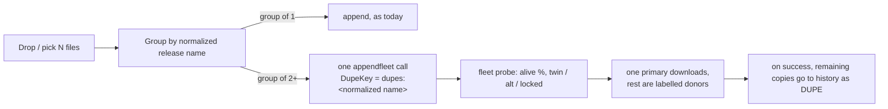

# Drop as fleet: NZBs added together are one fleet

Status: proposed (2026-11-22), not built.

## What happens today

Dropping several NZBs of the same release on the web UI at once (or picking them in the Add dialog) sends one `append` call per file (`webui/upload.js` `fileNext`), each with an empty DupeKey. RustyGet then treats them as unrelated downloads:

- no fleet probe, so no `DupeCopyKind` and no TWIN / borrowable alt / non-borrowable alt labels
- the success clean-up of queued copies never runs (`dupecoord.rs` `nzb_completed_host` needs a non-empty DupeKey), so after one copy finishes the next would start and download the release again
- dead copies are only found one at a time, as each reaches the head of the queue
- names differ only by a suffix the browser or indexer added (`…FraMeSToR_5.nzb`, `…FraMeSToR (1).nzb`), so name matching does not join them either

Seen on 2026-11-22 with 19 copies of one UHD remux dropped together: no labels, 15 dead copies parked one by one. A direct article check showed only 2 were alive, and both carried the same MKV as the rest (sampled bytes identical at the same offsets).

## Wanted

**NZBs added together in one action are one fleet when they are the same release.**

1. **Grouping** happens in the Add dialog, before upload. Use the same normalization the daemon uses for dupe keys (`releasename::normalize`), and also strip trailing copy suffixes: `_N`, ` (N)`, `-N`, and a repeated `.nzb`. Files whose normalized names match form one group. A group of one stays a plain `append`.
2. **One fleet per group:** send `appendfleet` with all of the group's files, the dialog's category and priority, and DupeKey `dupes:<normalized name>`. If the user typed a DupeKey in the dialog, use theirs instead.
3. **The dialog shows the grouping** before Submit ("19 files → 1 fleet: Dune.Part.Two…FraMeSToR"), so the user can see what will happen. Add a checkbox, on by default: "Add copies of the same release as one fleet". When it's off, every file goes in on its own as today.
4. **Force** (the "DupeForce" box) keeps today's behaviour: every file is its own download, with no fleet.
5. **Exact duplicate files** (same content) are dropped in the dialog before upload, so they don't cost a probe.

## Out of scope here, possible follow-ups

- NzbDir scanner: treat files of one release that land in the same scan pass as one fleet.
- Daemon side: items with no DupeKey and the same normalized name (copy suffix ignored) already in the queue join as one group, whatever added them.

## Done when

- Dropping 3+ copies of one release creates a single fleet: one item downloading, the others labelled TWIN / borrowable alt / non-borrowable alt in Downloads.
- After the primary succeeds, the other copies go to history as DELETED/DUPE, and nothing re-downloads.
- Dropping copies of two different releases at once creates two fleets.
- With the checkbox off, or with Force on, behaviour is exactly as today.
- Web UI tests cover the grouping (suffix stripping, two releases, a single file, a user-supplied DupeKey).
