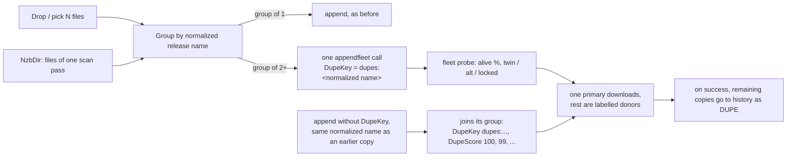

# Drop as fleet: NZBs added together are one fleet

Status: built (2026-11-22), with both follow-ups: the NzbDir scanner and the
daemon-side join.

## What happened before

Dropping several NZBs of the same release on the web UI at once (or picking them in the Add dialog) sent one `append` call per file (`webui/upload.js` `fileNext`), each with an empty DupeKey. RustyGet then treated them as unrelated downloads:

- no fleet probe, so no `DupeCopyKind` and no TWIN / borrowable alt / non-borrowable alt labels
- the success clean-up of queued copies never ran (`dupecoord.rs` `nzb_completed_host` needs a non-empty DupeKey), so after one copy finished the next would start and download the release again
- dead copies were only found one at a time, as each reached the head of the queue
- names differ only by a suffix the browser or indexer added (`…FraMeSToR_5.nzb`, `…FraMeSToR (1).nzb`), so name matching (`dupecoord.rs` `same_name_or_key`, exact names when there is no DupeKey) did not join them either

Seen on 2026-11-22 with 19 copies of one UHD remux dropped together: no labels, 15 dead copies parked one by one. A direct article check showed only 2 were alive, and both carried the same MKV as the rest (sampled bytes identical at the same offsets).

The same day the user copied about 15 NZBs of `Dune.Part.Two.2024.UHD.BluRay.2160p.TrueHD.Atmos.7.1.DV.HEVC.REMUX-FraMeSToR` into NzbDir with Finder. That path goes through the NzbDir scanner, not the web UI, and showed the same faults: every copy DupeKey '' and DupeScore 0, all downloading at once, nine of them parked as FAILURE/HEALTH with "no duplicate in history to fail over to" while three siblings were still queued, and a shown health of 98.8 to 99.9% for copies judged on a projected 0%.

## Built

**NZBs added together are one fleet when they are the same release, whatever added them.**

### The name rule

One normalizer, in Rust and mirrored exactly in JavaScript:
`releasename::group_name` (`rust/src/releasename.rs`) is `releasename::normalize`
of the name without its copy suffix (`releasename::strip_copy_suffix`), and
`DupeGroup.groupName` (`webui/dupegroup.js`) is the same code. The same cases run
in the Rust unit test `copy_suffixes_strip_only_after_a_group_tag` and in
`tests/webui/dupe-group.js`.

`strip_copy_suffix` removes:

- the scanner's `.queued`, `.N.queued` and repeated `.nzb` endings;
- a trailing ` (N)` (browsers), always: it is never part of a release name;
- a trailing `_N`, `-N` or `.N` of one to three digits, only when what is left
  still ends in a group tag, a last dot-separated word holding a `-` followed by
  a letter (`…REMUX-FraMeSToR_5`, `…1080p-GRP_2`).

Without such a tag the digits may be the name itself, so they stay:
`Movie.Part.2`, `DDP5.1`, `Show.S01E01-02`, `H-264`. A group that ends in a digit
without a separator (`-D3FiL3D`, `-EPSiLON2`) is never touched. The one case the
rule can't tell apart is a group whose own tag ends in a separator and digits
(`-GRP_2` against a copy of `-GRP`); such groups are rare, and the two copies of
it would still group with each other.

The DupeKey of a group is `dupes:<group name>`, for example
`dupes:dune.part.two.2024.uhd.bluray.2160p.truehd.atmos.7.1.dv.hevc.remux.framestor`.

### Web UI (Add dialog)

1. **Grouping** happens in the Add dialog, before upload (`webui/upload.js`,
   `DupeGroup.plan`). Files whose group names match form one group. A group of
   one stays a plain `append`.
2. **One fleet per group:** `appendfleet` with all of the group's files, the
   dialog's category and priority, and DupeKey `dupes:<group name>`. If the user
   typed a DupeKey for one of the files, theirs is used instead. A file with a
   password goes in on its own, as a fleet has no per-copy parameters.
3. **The dialog shows the grouping** before Submit ("19 files → 1 fleet:
   Dune.Part.Two…FraMeSToR"), with the checkbox "Add copies of the same release
   as one fleet", on by default. When it's off, every file goes in on its own as
   before, with the nzb parameter `DupeJoin=no` so the daemon-side join leaves it
   alone too.
4. **Force** (the "DupeForce" box) keeps the old behaviour: every file is its
   own download in DupeMode FORCE, with no fleet and no join.
5. **Exact duplicate files** (same content) are dropped in the dialog before
   upload, so they don't cost a probe.

### NzbDir scanner (was follow-up a)

A plain `.nzb` dropped into NzbDir (not one the API wrote there) waits for the
end of the scan pass (`scanner.rs` `flush_fleet_pending`). Files of one release
(the same category and group name, `scanner::plan_fleets`) that landed in that
pass go in as one fleet through the same `appendfleet` code, on a thread of its
own, under DupeKey `dupes:<group name>`. A copy of the release that lands within
`FLEET_WINDOW_SEC` (10 s) of a fleet started from NzbDir joins that fleet the
same way (the fleet's "backup sent later" path). A file alone in its pass is
added as before. The original files are renamed `.queued` as before; the file
of each copy the fleet added is then removed, since the fleet wrote its own.
This needs `DupeCheck=yes`, and is off while a scan script is set.

### Daemon side (was follow-up b)

`dupecoord.rs` `join_copy_group_host`, called first in the duplicate check of
every new download: a download without a DupeKey, not in DupeMode FORCE and not
marked `DupeJoin=no`, joins the queued or history downloads of the same group
name that have no DupeKey either (or already have the group's key). All of them
get the DupeKey `dupes:<group name>` and a DupeScore in the order they came
(`DupePrimaryScore`, 100 by default, for the first, then 99, 98, ...;
`dupecoord::next_group_score`), and the log says "Grouping X with N other
copy(ies) of the same release". The duplicate check that follows then does what
NzbGet's DupeMode SCORE always did: the copy that came first downloads, the
rest wait in history as backups, and TwinCheck labels each one (it only looks at
downloads with a DupeKey).

### To the front, probed with about 1 MB each

A group goes to the front of the queue at once: a fleet with a `dupes:` key adds
its copies at the top (`dupesearch_coord.rs` `scanner_add_external`, `add_top`),
and the daemon-side join moves the queued copies of the group to the top.

Each copy is scored from a probe of about 1 MB of articles
(`dupesearch_coord.rs` `GROUP_PROBE_BYTES`), never by downloading it:

- the STAT checks spread over the whole posting cost no bytes, so a dead tail
  shows in the alive share;
- the kind probe reads two articles (the par2 file list and the head of the
  largest file: twin by par2 list, encrypted or locked headers);
- the BODY checks get what is left of the 1 MB (`group_probe_body_checks`, at
  least one, never more than `DupeBodyChecks`);
- the payload intake, which reads an article of every volume to map the video
  inside, is skipped for such a group: copies of one release name are matched
  by TwinCheck's par2 lists instead, and an unverified copy stays in the fleet.

After the probe only the best copy downloads. The others stay as scored,
labelled backups that lend articles when the primary misses them; no backup is
downloaded in full while the primary can still finish.

### Imperfect copies stay donors

Only the best copy downloads. Every other copy stays in the fleet as a backup
(DELETED/DUPE in history) ranked by its alive percentage, which the web UI shows
beside it ("donor · 48.0% alive"); a copy with nothing alive is shown as "dead
donor" and keeps its nzb-file. A copy that is tried and fails its health check
(parked) while its fleet is open is no longer filed FAILURE/HEALTH:
`dupecoord.rs` `keep_as_donor_host` files it as a backup too, with its measured
alive share as `DupeAlive` and `DupeParked`, keeps its files and nzb-file, and
failover never picks it again (`tried_delete_status` shows it to failover and
the duplicate check as parked on health). The fleet is open while another copy
of its key is queued or waits in history and none succeeded. The parking
message also counts the copies still queued ("N other copy(ies) of it still
queued, so it stays in their fleet as a donor"). After the primary succeeds the
remaining copies are in history as DELETED/DUPE, and nothing downloads again.

### Honest health

A download judged from a sample (dead or doomed from the articles tried so far,
or hopeless) gets the nzb parameter `DupeProjected`: the projected health in
percent. Its `Health` still counts every untried article as good, which is why
a copy projected at 0% showed 98.8% before. The web UI shows "projected health:
N%" instead of the health label for such a download, uses it in the score
badge, and shows a kept donor's `DupeParked` the same way.

### Classification rules (F6 to F10)

- **Timeouts are never evidence (F6).** The fleet's health check counts only
  articles a server said it has or lacks (`dupesearch_nzb.rs`
  `eval_fleet_member_health`); a check that timed out or failed with a
  temporary error leaves the copy unknown: Alive -1, no `DupeAlive`, never
  DEAD and never 0% alive. The intake already leaves a copy it ran out of time
  for unverified, and TwinCheck retries a sample that read too little.
- **The check budget is per copy (F7).** A grouped fleet's time limit is 60 s
  for each copy (`group_check_timeout_sec`), and its kind probe gets up to 60 s
  for each round of 16 copies, instead of one window for the whole fleet.
- **The nzb's password reads encrypted headers (F8).** The kind probe reads a
  copy's first archive article with the password from its `<meta
  type="password">` or a `{{password}}` in its name (`summary_password`,
  `summary_take_name_password`); `donorkind::rar_packing` opens encrypted RAR
  headers with it (zipfast). A 7-Zip keeps its headers at its end, so a
  passworded 7-Zip is classed encrypted from the password alone.
- **Other par2 checksums are other packing, not another video (F9).** TwinCheck
  labels such a copy `container` until the video inside both copies matches
  (`DupeInner`), which makes it an `alt`. The web UI shows `container` as
  "unverified" (`DupeGroup.kindLabel`), never as another encode.
- **The primary is the healthy copy easiest to borrow into (F10).** After
  ranking, the healthy copy (at least 97.5% alive, not locked) with the easiest
  packing leads (`donorkind::primary_ease`, `dupesearch_nzb::lead_easiest_healthy`):
  bare or split media, then a stored archive, then a compressed archive or a
  7-Zip, then an encrypted one. Health still gates: a weak plain copy never
  leads a healthy one. The backups keep their order (twins first).

Open item (F2a): par-rs #87 is merged (b2ba9e5) but not pinned here yet; the 1 MB probe is to switch to
`par_rs::probe::{plan_probe, check_probe}` (slice-verified Match, Mismatch or
Incomplete; probed slices that match the same IFSC are twin evidence). It is
marked `OPEN ITEM (par-rs)` at `GROUP_PROBE_BYTES`.

## Done when (acceptance tests)

| Done when | Test |
|---|---|
| Dropping 3+ copies of one release creates a single fleet: one item downloading, the others labelled TWIN / borrowable alt / non-borrowable alt in Downloads. | functional `dropnzbdir` (NzbDir drop of 5 copies plus an exact copy: one primary, every other copy DupeKey `dupes:…`, DupeScore > 0, the partly alive copy `DupeKind=twin`, the dead ones `DupeAlive=0`); web UI `tests/webui/dupe-group.js` "suffixed copies form one fleet" |
| After the primary succeeds, the other copies go to history as DELETED/DUPE, and nothing re-downloads. | functional `dropnzbdir` (one SUCCESS, the other copies DELETED/DUPE, no article tried by any backup), `dropjoin` |
| Dropping copies of two different releases at once creates two fleets. | functional `dropnzbdir` (second release, its own key and one SUCCESS); web UI `dupe-group.js` "two releases form two fleets"; Rust `scanner::tests::nzbdir_copies_of_one_release_form_one_fleet` |
| A partially alive copy (for example 19 of 40 sampled articles) stays queued as a low-priority donor with its alive % shown. It is not marked FAILURE/HEALTH, and the primary borrows from it. | functional `dropnzbdir` (19 of 30 alive: DELETED/DUPE with its DupeAlive, labelled a twin by TwinCheck, the primary recovers its 2 missing articles from it); `dropkeepdonor` (a tried copy that fails its health check is kept as a donor, DELETED/DUPE, not FAILURE/HEALTH) |
| A copy with nothing alive is labelled dead, stays in history with its nzb, and is never deleted. | functional `dropnzbdir` (`DupeAlive=0`, nzb-file still in NzbDir), `dropkeepdonor` (`DupeParked` near 0, nzb-file kept) |
| Exact duplicate files are dropped before upload. | web UI `dupe-group.js` "exact duplicate files are dropped before upload"; functional `dropnzbdir` (the exact copy in NzbDir is SAME_POSTING, not added) |
| With the checkbox off, or with Force on, behaviour is exactly as today. | web UI `dupe-group.js` "box off or Force on: every file on its own, as before"; functional `dropjoin` (`DupeJoin=no` and DupeMode FORCE copies keep no DupeKey and each downloads) |
| Web UI tests cover the grouping (suffix stripping, two releases, a single file, a user-supplied DupeKey). | `tests/webui/dupe-group.js`; Playwright `tests/webui/drop-fleet.js` (the Add dialog's preview, box on by default, box off and Force as plain appends, two releases as two fleets; Downloads: one primary, twin, alt and unverified backups, projected health; History: donors never FAILURE/HEALTH, DELETED/DUPE after the primary succeeds; no console errors) |
| The NzbDir scanner treats files of one release in one scan pass as one fleet. | functional `dropnzbdir`; Rust `scanner::tests::nzbdir_copies_of_one_release_form_one_fleet` |
| Items with no DupeKey and the same normalized name join one group, whatever added them. | functional `dropjoin`; Rust `dupecoord::tests::group_scores_follow_the_order_copies_came` |
| A group goes to the front of the queue, and each backup sends at most about 1 to 2 MB during intake. | functional `dropnzbdir` (queue order with an item queued before the drop; nserv request log: bytes served per backup copy at most 2 MB, borrowed articles included), `dropjoin` (the joined copy moves in front of an item queued before it); Rust `dupesearch_coord::tests::grouped_fleets_probe_about_a_megabyte_per_copy` |
| The shown health is the one a copy was judged on. | functional `dropkeepdonor` (Health above 90%, DupeProjected under 10%) |
| F6: a copy whose checks timed out is unverified, never dead. | Rust `dupesearch_nzb::tests::timeouts_leave_a_fleet_copy_unverified`; functional `fleettimeoutunverified` |
| F7: the check budget is per copy. | Rust `dupesearch_coord::tests::grouped_fleets_check_each_copy_for_a_minute` |
| F8: encrypted headers are read with the nzb's password. | Rust `dupesearch_coord::tests::fleet_copies_carry_the_nzb_password`, `donorkind::tests::header_encrypted_rar_with_its_password_is_borrowable_encrypted`; functional `fleetnzbpassword` (RAR5 -hp fixture, password only in the nzb meta: borrowable-encrypted; missing password locked; never DEAD), `fleetencryptedpassword` (needs `rar`) |
| F9: another container shows unverified until the video inside matches. | Rust `twin::tests::par2_differences_alone_never_make_an_alt`; web UI `dupe-group.js` "F9: another container is unverified" |
| F10: the primary is the healthy copy easiest to borrow into. | Rust `donorkind::tests::primary_ease_orders_bare_stored_compressed_encrypted`, `dupesearch_nzb::tests::the_primary_is_the_healthy_copy_easiest_to_borrow_into`; functional `fleetprimaryease`; functional `dropdune` (the Dune drop in small: stored RAR primary over a healthy header-encrypted RAR5 with the nzb password, twins, repacked and shorter copies as unverified containers, dead copies kept with their nzb, the 1080p release apart) |
| The name rule strips only a copy suffix. | Rust `releasename::tests::copy_suffixes_strip_only_after_a_group_tag`; web UI `dupe-group.js` (the same cases) |

Run the web UI test with `node tests/webui/dupe-group.js` (plain Node, no
browser, no daemon) and the functional ones with
`python3 tests/functional/dupefallback/harness.py --nzbget build/debug/rustyget --scenario dropnzbdir,dropjoin,dropkeepdonor`.
